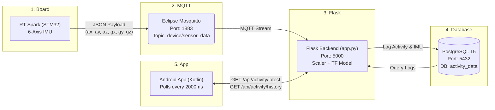

# Activity Recognition IoT

Real-time walking/running recognition using an RT-Spark (STM32) board, MQTT, a Flask REST API, PostgreSQL, and an Android app.

## Overview

This project collects motion data from an embedded sensor board, sends it through MQTT, predicts the activity in a Python backend, stores the result in a database, and displays it in a mobile app.

### System Architecture Diagram



## Project Structure

- `mobile-app/` — Android app built with Kotlin
- `backend/iot_backend/` — Flask API, ML model, MQTT subscriber, database logic
- `firmware/ActivityRecognition_RT_Spark/` — firmware for the RT-Spark board
- `docs/` — diagrams, notes, screenshots, and design files
- `README.md` — project overview and setup guide

## Features

- Real-time activity classification for walking and running
- MQTT-based sensor streaming
- Flask REST API for latest and historical data
- PostgreSQL storage for activity logs
- Android UI showing live prediction and recent activity history
- Support for mock data while testing the app without the backend

## Architecture

### 1) Embedded sensor device
The RT-Spark board publishes accelerometer and gyroscope readings over MQTT to the backend.

### 2) Backend
The Python backend:
- loads the trained TensorFlow model and scaler
- listens for incoming sensor payloads
- classifies the activity using the ML model
- stores the result in PostgreSQL
- exposes API endpoints for the mobile app

### 3) Mobile app
The Android app requests the latest prediction and recent history from the backend and displays them visually.

## API Endpoints

- `GET /api/activity/latest` — returns the most recent prediction
- `GET /api/activity/history?limit=N` — returns recent activity logs

Example response for `/api/activity/latest`:

```json
{
  "timestamp": "2026-10-21 10:20:30",
  "activity": "walking",
  "accelerometer": {"x": 0.42, "y": 0.18, "z": 9.81},
  "gyroscope": {"x": 1.10, "y": 0.55, "z": -0.32}
}
```

## Backend Setup

### Requirements

- Python 3.10+
- PostgreSQL
- Mosquitto MQTT broker
- TensorFlow / Keras
- joblib
- Flask
- psycopg2
- paho-mqtt

### 1) Start PostgreSQL
Create a database called `activity_data` and a user with access to it.

Example configuration used by the backend:

```python
DB_CONFIG = {
    "host": "localhost",
    "database": "activity_data",
    "user": "admin",
    "password": "password",
    "port": 5432
}
```

### 2) Start MQTT broker
Run a local MQTT broker such as Mosquitto.

### 3) Run the Flask app
From `backend/iot_backend/`:

```bash
python app.py
```

The app will:
- load the model and scaler
- initialize the database table if needed
- connect to MQTT
- serve the API on `http://0.0.0.0:5000`

## Mobile App Setup

### Requirements

- Android Studio
- Android device or emulator

### Run the app
1. Open `mobile-app/` in Android Studio.
2. Let Gradle sync finish.
3. Open `AppConfig.kt`.
4. Set the backend IP and enable the real backend.

File to edit:

```kotlin
object AppConfig {
    const val BASE_URL = "http://192.168.254.124:5000"
    const val USE_MOCK_DATA = false
    const val HISTORY_LIMIT = 20
    const val REFRESH_INTERVAL_MS = 2000L
}
```

Notes:
- Use the IP address of the machine running the backend.
- The phone and backend laptop must be on the same Wi-Fi network.
- For local testing, mock mode can be enabled temporarily with `USE_MOCK_DATA = true`.

## Firmware Setup

The firmware is under `firmware/ActivityRecognition_RT_Spark/` and is intended for the RT-Spark board.

### Typical workflow
1. Open the project in RT-Thread Studio or the appropriate STM32 toolchain.
2. Configure the board pins and peripheral settings.
3. Publish sensor data to MQTT using the project-defined message format.
4. Verify the backend receives and processes the payload.

## Expected Sensor Payload

The backend expects sensor data shaped like this:

```json
{
  "ax": 0.42,
  "ay": 0.18,
  "az": 9.81,
  "gx": 1.10,
  "gy": 0.55,
  "gz": -0.32
}
```

## Model Evaluation

The activity recognition model is a lightweight 1D-CNN that classifies walking vs running from a **window of the last 10 sensor readings** (time-series input), so it learns patterns over time instead of judging a single reading.

Input per reading (6 channels):

- Acceleration X, Y, Z (g)
- Gyroscope X, Y, Z (rad/s)

The RT-Spark sends raw sensor counts, so the backend converts them to the dataset's units (g and rad/s) before prediction.

The dataset was split by whole recordings (80% training, 20% testing), so test windows never come from a recording used for training.

### Test Result

**Test accuracy (held-out recordings): 100.00%**

This was measured on held-out recordings from the walking/running dataset, which comes from a single user. Performance on other users and on live board data may differ.

## Important Notes

- The project currently assumes a local network and local services.
- The backend is a functional prototype and can be improved for production use.
- Model loading and database configuration should be externalized for cleaner deployment.

## Recommended Next Improvements

The current implementation is a solid proof-of-concept. The next improvements should focus on reliability and maintainability:

- move hardcoded config into environment variables
- separate model, DB, MQTT, and routing logic into modules
- add health checks and API validation
- improve logging and error handling
- add Docker Compose for backend + PostgreSQL + MQTT
- add automated tests for inference and API routes
- improve Android error handling and offline states
- document hardware wiring and calibration steps more clearly

## Team

- Shaqkobe Dos P. Tejada — Firmware & Backend
- Cassandra Khan P. Mendoza — Mobile app
- Carl Hovan B. Chan — Documentation, testing and Demo
- Sean Marie G. Rabago - Demo, Documentation and testing

Section B187.1, MSU-IIT CCS

## License

This project is licensed under the MIT License. See `LICENSE` for details.
