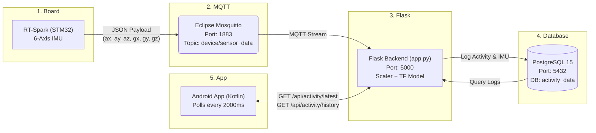

## Demo Video
[Show Demo Video and Firmware and Database](https://drive.google.com/file/d/1kHNwug51wmhMD1VeQ5g_qIJRqC735n6P/view?usp=sharing)

## System Integration and Test Environment

The demonstration validates the end-to-end data pipeline of the activity recognition architecture. The RT-Spark (STM32) board was configured to sample 6-axis IMU data and transmit the JSON payload via MQTT over a local network. The Python backend, running concurrently with a Mosquitto MQTT broker and a PostgreSQL instance on the host machine, successfully ingested the `device/sensor_data` stream. The Android client, connected to the same local network, polled the REST API at 2000ms intervals to retrieve and display inferences.

### System Architecture Diagram

## Testing Methodology

To evaluate real-time classification, live physical testing was conducted. A tester performed the target activities (walking and running) while equipped with the RT-Spark sensor board. The tester transitioned between resting, walking, and running states to evaluate the model's dynamic response and transition time. The demonstration video captures both the physical movements of the tester and the simultaneous state changes displayed on the Android application interface to correlate the physical inputs with the software output.

## Demonstration Observations

* **Pipeline Latency:** The system exhibited minimal delay between the physical motion and the corresponding UI update on the mobile application, confirming the efficiency of the MQTT-to-Flask-to-REST routing.
* **Classification Accuracy:** The backend TensorFlow model successfully differentiated between walking and running states based on the raw `ax`, `ay`, `az`, `gx`, `gy`, and `gz` variables.
* **Data Persistence:** Post-test verification of the PostgreSQL database confirmed that the activity states and sensor payloads were continuously logged with accurate timestamps during the demonstration runtime.
* **Client Stability:** The Android application successfully handled the real-time polling without dropping the connection, properly parsing the JSON responses from the `/api/activity/latest` and `/api/activity/history` endpoints.
